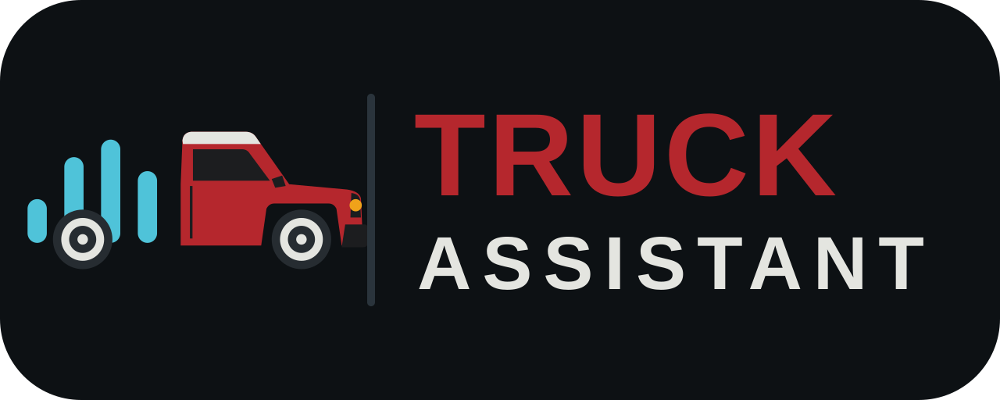
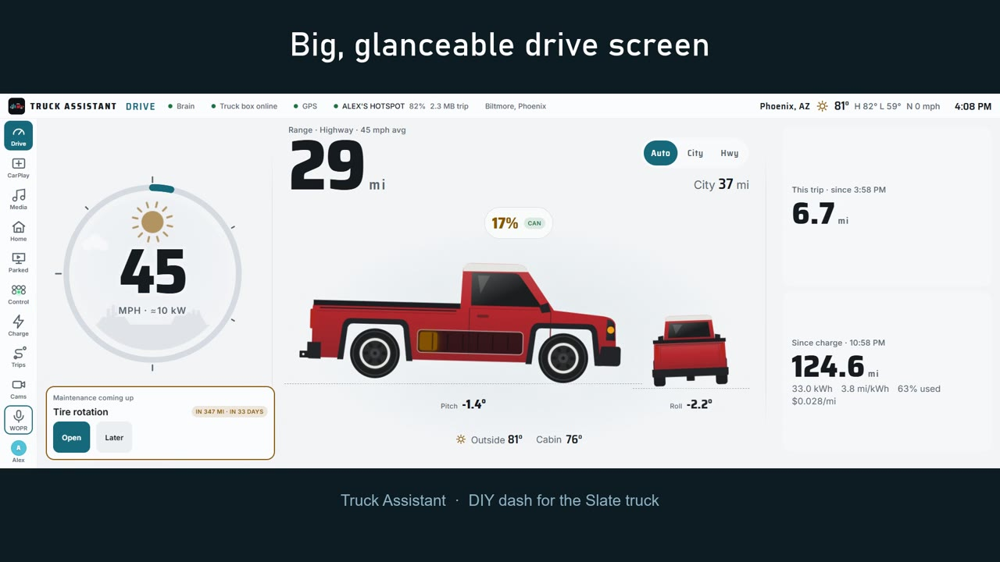

# Truck Assistant

A DIY touchscreen dash for the Slate truck, which ships with no screen, no radio
and no modem. The goal is CarPlay (Waze, music), charging and trip info,
Home Assistant, cameras and aux-switch control on one large, clean screen.
Built for Jeff's truck first, published for other Slate owners later.

[](docs/media/truck-assistant-demo.mp4)

*30-second desk demo ([watch the video](docs/media/truck-assistant-demo.mp4)): a simulated truck, invented data and stock camera footage.*

> **Not affiliated with Slate Auto.** This is an independent DIY project; it
> is not made, endorsed or supported by Slate Auto. MIT licensed (`LICENSE`).
> The public name is undecided: it is one constant in `brain/src/project.ts`.

## Status

- **Software core (2026-11-05):** `brain/` (Node 24 service on :8080) and
  `ui/` (Preact cockpit + `/settings` portal), built against
  `docs/contract.md`. Runs on a desk with a simulated truck:

  ```sh
  npm install
  npm run dev      # brain with SIM=1 on :8080 + Vite on http://localhost:5173
  npm test         # brain + UI unit tests (vitest)
  npm run build    # UI to ui/dist, brain to brain/dist
  npm start        # the built brain; serves the cockpit at / and settings at /settings
  ```

  Env (plumbing only; API keys go on the settings page): `PORT` (8080),
  `DATA_DIR` (./data: settings.json + cockpit.db), `SIM=1`, `SIM_SPEEDUP`,
  `MQTT_URL` (mqtt://localhost:1883), `MQTT_DISABLED=1`, `GPSD_HOST`/`GPSD_PORT`.
  No MQTT broker or gpsd needed on a desk: the brain reports them in
  `/api/health` and keeps working. Pi install: `sudo ./deploy/pi/install.sh`
  (systemd unit, Chromium kiosk at 1920x720, Mosquitto with a home-bridge
  template). CarPlay: the CarPlay view drives a Carlinkit dongle over WebUSB
  (`ui/src/carplay/`, vendored node-carplay 4.1.0); on a desk,
  `?carplaySim=1` (or the test panel's CarPlay switch) plays a test clip
  through the same path. Pi setup and
  dongle notes: `deploy/pi/README.md`.
- **Demo mode (screen recordings):** build the UI, then in `brain/`:
  `DEMO=1 PORT=8096 DATA_DIR=<an empty folder> node --disable-warning=ExperimentalWarning src/index.ts`
  and open http://localhost:8096 at 1920x720. Implies
  `SIM=1`. Every real integration is closed at start-up (`brain/src/demo/gate.ts`:
  fetch, WebSocket, raw sockets and commands like ssh/nmcli; only loopback and
  public weather/speed-limit/radio-directory hosts pass), and an invented house,
  calendar, mailbox, playlist and charger list answer in their place
  (`brain/src/demo/backend.ts`). An **empty** `DATA_DIR` is seeded with three
  weeks of invented trips, charges and logs for drivers Alex and Sam
  (`brain/src/demo/seed.ts`); a folder with anything in it is never touched, so
  never point it at a real truck's data. The top bar names a neighbourhood or
  freeway, not an address; the setup wizard is skipped; the test panel stays off
  the rail unless the page is opened with `?panel`. `DEMO_FOOTAGE=<folder>`
  makes each sim camera loop `<folder>/<camera id>.mp4` (front, rear, hitch,
  bed, surround) instead of the test pattern, and hides the ones with no clip.
  The same folder feeds the demo house's cameras on the Home screen:
  `home-<name>.jpg`, or a folder `home-<name>/` of numbered frames shown one a
  second (front_lawn, garage, doorbell). Keep stock clips in that folder, never
  in the repo.
- **Truck payoff goal (2026-11-05):** "pay off the truck with gas savings",
  tracked for good in a day-by-day SQLite ledger (closed months frozen;
  Recalculate on /settings). Charge view card, a Drive card when parked,
  /settings → Charging & costs (target, delivery date, adjustments, ledger,
  CSV), HA sensors and a line for WOPR. Only real truck trips count: trips
  and sessions logged under `SIM=1` are marked `simulated` and never do, so
  a SIM brain shows $0. Contract: "Payoff goal".
- **Charging on-peak alert (2026-11-05):** charging at home inside a TOU
  period marked "alert" (APS 4–7pm weekdays) sends a phone alert (Track C,
  every 15 min while it lasts), shows a red banner and sets an HA
  binary_sensor; plugged in during the 30 min before gets a heads-up. With
  `homeRate.demandPerKw` set it says what one hour adds in demand charges.
  Contract: "Charging on-peak".
- **Media and WOPR (Track B, 2026-11-05):** a MEDIA view (CarPlay, Spotify
  Connect, internet radio with KJEF, AM/FM on an RTL-SDR, Plex, files, Apple
  Music via CarPlay), the WOPR voice button, next appointment to Waze, gate
  codes on arrival, and charging receipts to confirm. Set up on /settings
  (WOPR, Spotify, Plex, AM/FM). Desk test without WOPR:
  `node scripts/mock-wopr.mjs` (login jeff / test). Details: `docs/contract.md`
  (Track B) and `deploy/pi/README.md` (Media).
- **Drivers, stops, phone history, gas prices, getting online (2026-11-05):**
  driver profiles (Jeff, Sam, Jordan, Guest) with their own theme, layout,
  charging prefs and gas comparison vehicle; stops named from saved places,
  HA zones, a places feed or OpenStreetMap; trips shown stop → stop; replay of
  a phone's location history from Home Assistant; GasBuddy prices via HA;
  the cockpit online through the driver's hotspot (NetworkManager). Design:
  `docs/drivers-and-stops.md`, `docs/connectivity.md`. Needs the HA URL and a
  long-lived token on `/settings`; without them everything else still works.
- **Cameras and the truck while away (2026-11-05, Track C):** Cams view with
  live WebRTC through go2rtc (grid or one camera, rear camera with parking
  guides in reverse, latency per tile), dashcam loop on the SSD with Save clip
  (60 s before + 30 s after) and parked motion clips, alerts to HA's companion
  app or ntfy, theft ("moved without a driver"), the phone Truck page at
  `/truck`, and the always-on LTE-M watch that wakes the Pi
  (`firmware/watch`). On a desk `SIM=1` shows five moving test cameras (MJPEG
  from ffmpeg when go2rtc isn't installed). Design: `docs/remote.md`.

- **Logs, ops, publishing (Track D, 2026-11-05):** business mileage log
  with auto-tagging and IRS export (CSV + printable), maintenance log and
  reminders with receipt photos, TPMS history, software updates from GitHub
  with automatic rollback, nightly backups to the NAS, a password for
  `/settings` and `/truck`, a first-boot setup wizard, a pi-gen image, a
  release workflow, the hardware list (`docs/bom.md`) and the ESP32-P4 second
  screen (`firmware/p4-screen/`). Security and the stolen-truck checklist:
  `docs/security.md`. Contributing: `CONTRIBUTING.md`.
- **Prototype UI:** `prototype/index.html`. Open it in any browser; all data is
  simulated. Views: Drive, CarPlay, Control, Truck, Cams, Plan.
- **Main screen (changed 2026-11-06): Jeff's Samsung Galaxy Tab S7 FE**
  (SM-T738U, 12.4" 2560×1600) in Slate's Tablet Mount, running the cockpit in
  Chrome; the Pi under the dash stays the brain and the tablet reaches it over
  the truck's Wi-Fi. CarPlay's dongle plugs into the tablet; the Parked screen
  opens the real Android streaming apps. Setup and the desk test:
  `deploy/android/README.md`. The bar screen below is the alternative now.
- **Hardware (decided 2026-11-05, screen superseded above):** one Pi brain under the dash, driving a
  **12.3" 1920×720 bar touchscreen set into a dash panel opening** (CarPlay,
  cameras, browser) and/or a cheap ESP32-P4 panel (gauges, switches).
  Candidate: Waveshare 12.3" HDMI capacitive, 301.2 × 123.35 × 12.4 mm, into
  an opening forum-measured at 13 7/8 × 5 1/4 in (352 × 133 mm). Its 600-nit
  rating is unverified (one listing says 300) and low for Phoenix sun, so it
  gets a printed hood. Depth behind the dash panel is unmeasured. The
  prototype has a 12.3" BAR preview button. Android head unit ruled out. Pi 4 vs Pi 5 is
  settled on the bench. Comparison: `docs/options.html`.
  - `docs/plans/plan-pi5.md`: the main-screen half
  - `docs/plans/plan-pi-esp32.md`: the small-screen half
  - `docs/plans/plan-android.md`: not chosen, kept for the record
- **Feature ideas from other EVs:** `docs/ev-features.md`
- **What the Slate forums say** (truck data, speakers, Five Switch, dash
  sizes, backup camera): `docs/forum-findings.md`. Mostly claims from
  prototypes; production deliveries for most reservations look like Q2 2027.

## Wants

1. Charge info and where to charge, ranked by my preferences
2. Waze for navigation
3. Media dashboard
4. Super clean look, customizable
5. Inexpensive yet reliable (Phoenix cab heat)
6. Cameras, ideally a 360° view
7. Web browser
8. Web portal to manage settings, streaming services and accounts
9. Home Assistant integration
10. Route and trip tracking

## Slate accessories to integrate

Five Switch (Upgrade), Bed Light Kit, front L/R and center integrated speakers,
Hands Free Bluetooth Controller, Tablet Mount, Classic Level 2 Wall Charger,
2" hitch receiver, tailgate lock, NEXUS tonneau.

## Layout

| Folder | What |
|---|---|
| `prototype/` | The web UI prototype |
| `docs/` | Plans, research, decisions |
| `print/` | 3D-printed parts: models, print settings |
| `hardware/` | Wiring, parts lists, pinouts (once a path is picked) |

## 3D printing

Anything that mounts in the cab gets printed in **ASA or PETG-CF**, not PLA.
A parked Phoenix dash gets hot enough to warp PLA in an afternoon. See
`print/README.md`.

## Running it on the homelab (NAS)

A copy runs on the NAS at **http://192.168.1.20:3950** (LAN only; port 3950 is
not forwarded and must not be). It uses the image GitHub builds on every push
to main (`ghcr.io/jraben/truck-assistant`, named after the repo) and `deploy/nas/docker-compose.yml`,
copied to `~/slate-cockpit/` on the NAS. With no truck, `SIM=1` drives a
simulated one, and **More › Test panel (SIM)** drives it by hand: gear,
ignition, speed, which leg of the route, plugging in to charge (home 7.2 kW at
60×, DC fast 150 kW at 10×, or set the level outright), cabin heat, a weak 12V battery, a low
tire, the Five Switch, a bump and a tow-away (the theft alert), every desk
camera live, and the CarPlay simulator on or off. The panel's routes
(`/api/sim*`, `brain/src/simRoutes.ts`) answer 404 on a real truck. To update after a push, once the "Build image" action is green:

```sh
cd ~/slate-cockpit && sudo -n /usr/local/bin/docker-compose pull && sudo -n /usr/local/bin/docker-compose up -d
```

The folder, compose project and container keep their older `slate-cockpit`
name so the data volume carries over. Data lives in the `slate-cockpit_slate-data` Docker volume. The compose file
uses the built-in bridge network because the NAS has no free address pools for
a new one.
