# Desk install: build and test everything before it goes in the truck

This guide walks you through setting Truck Assistant up **on a desk or
workbench**, one piece at a time. It assumes you have never done this before.
When you finish, every part has been switched on and checked, and the
[truck install](truck.md) is mostly moving it into the truck and plugging it
in.

> **Why start on a desk?** A truck is a bad place to find a problem. It's hot,
> the light is bad, the wires are behind panels, and you can't just reach for a
> laptop. On a desk you can see everything and undo anything.

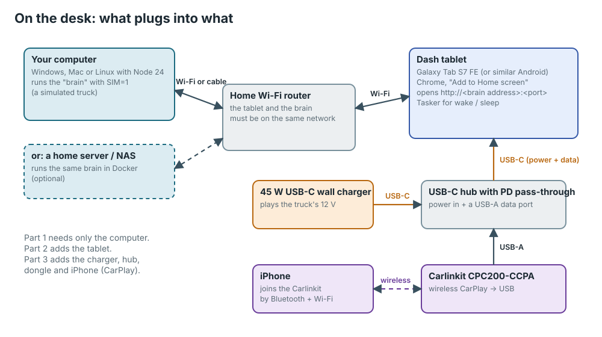

## How this guide is laid out

Each part builds on the one before it. You can stop after any part and
still have something that works.

| Part | What you do | Hardware needed | Time |
|---|---|---|---|
| [1](#part-1-run-the-software-on-your-computer) | Run the software on your computer with a pretend truck | A computer | 30 min |
| [2](#part-2-learn-your-way-around) | Learn the screens and the test panel | Same | 20 min |
| [3](#part-3-the-dash-tablet) | Set up the dash tablet, CarPlay and Tasker | Tablet, charger, hub, Carlinkit, iPhone | 1–2 h |
| [4](#part-4-the-raspberry-pi-brain-on-the-bench) | Build the Raspberry Pi "brain" that lives under the dash | Pi kit, 12 V bench supply | 2–3 h |
| [5](#part-5-the-truck-box-on-the-bench) | Flash and test the ESP32 "truck box" (relays and sensors) | Relay board, USB-serial adapter | 1–2 h |
| [6](#part-6-sign-off-checklist) | A final checklist | Everything | 15 min |

Parts 1–3 need **no soldering and no wiring**. Parts 4 and 5 involve a 12 V
bench supply and screw terminals; no soldering is needed there either, except
for the few small parts noted in Part 5.

**Words you'll see a lot:**

| Word | Means |
|---|---|
| **Brain** | The program that runs the whole system. In the truck it runs on the Raspberry Pi under the dash; on a desk it can run on your computer. |
| **Cockpit** | The screen you look at: the web page the brain shows. On the truck it's on the tablet. |
| **Settings page** | The same brain at `/settings`: where every name, key and password goes. |
| **Truck box** | A small ESP32 board with relays and sensors that touches the truck's 12 V wiring. |
| **SIM** | "Simulated truck." The brain pretends to drive around Phoenix so the screens have something to show. |
| **Address** | Where the brain is on your network, like `http://192.168.1.50:8080`. You type it into a browser. |

---

## Part 1: Run the software on your computer

You need a Windows, Mac or Linux computer. No truck hardware yet.

### 1.1 Install two free programs

1. **Node.js version 24 or newer.** Go to [nodejs.org](https://nodejs.org),
   download the installer marked "LTS" (it must say 24 or higher), and run it
   with all the default choices.
2. **Git.** Go to [git-scm.com](https://git-scm.com/downloads), download it
   for your system and install it with the default choices.

Check they worked. Open a terminal:

- **Windows:** press the Start key, type `PowerShell`, press Enter.
- **Mac:** press ⌘ Space, type `Terminal`, press Enter.

Then type each line and press Enter:

```sh
node --version
git --version
```

You should see something like `v24.18.1` and `git version 2.47.0`. If Node
says a number below 24, install it again from nodejs.org.

### 1.2 Download Truck Assistant

In the same terminal:

```sh
git clone https://github.com/jraben/truck-assistant.git
cd truck-assistant
npm install
```

`npm install` downloads everything the program needs. It takes a few
minutes and prints a lot of text; that's normal. Warnings are fine. It's done
when you get your prompt back.

### 1.3 Build it and start it with a pretend truck

```sh
npm run build
```

Then start it. The command is slightly different on each system:

| System | Type this |
|---|---|
| Windows (PowerShell) | `$env:SIM=1; npm start` |
| Mac or Linux | `SIM=1 npm start` |

After a few seconds you'll see a line ending in
`[brain] listening on http://localhost:8080`. **Leave this window open.**
Closing it stops the brain. To stop it on purpose, click in the window and
press **Ctrl + C**.

> **Windows firewall:** the first time, Windows may ask whether Node.js may
> use the network. Tick **Private networks** and click **Allow**. Without it
> the tablet can't reach your computer in Part 3.

### 1.4 Open the cockpit

Open Chrome (or Edge) on the same computer and go to
**http://localhost:8080**.

The first time, a **setup wizard** appears over the cockpit:

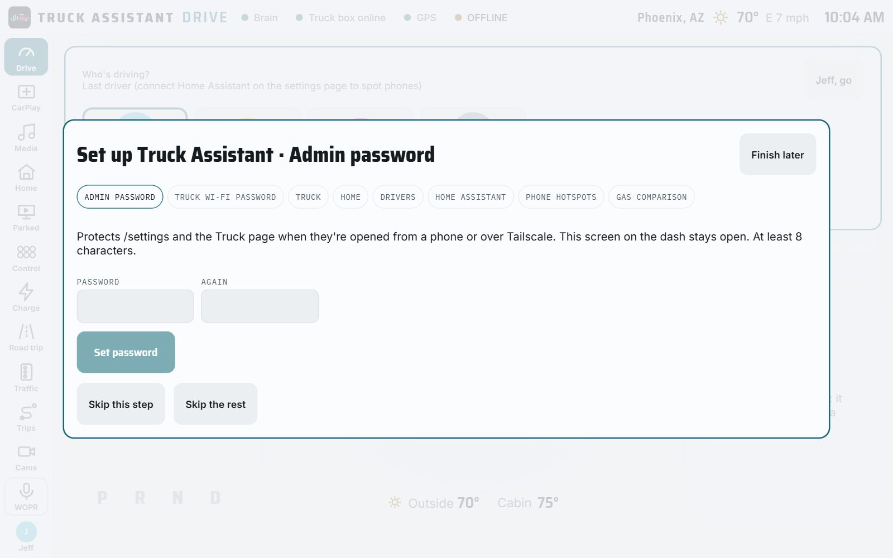

On a desk you can click **Finish later**. (You'll do it for real on the Pi in
Part 4.) You can always get back to it from the settings page.

If it asks **"Who's driving?"**, tap a name, then the **go** button on the
right.

You should now see the **Drive** screen with a red truck, a speed, a range
and a battery percentage. The numbers move: the pretend truck is driving.

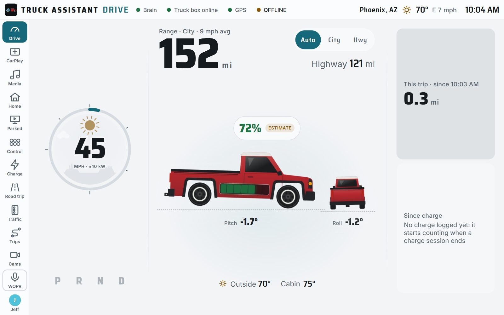

**Check:** the dots in the top bar read **Brain**, **Truck box online** and
**GPS**, all green. (**OFFLINE** in amber is normal on a desk: it's the
truck's own internet connection, which doesn't exist yet.)

### 1.5 Find your computer's address (for the tablet later)

The tablet needs to know where your computer is on your home network.

- **Windows:** in PowerShell type `ipconfig` and look for **IPv4 Address**
  under your Wi-Fi or Ethernet adapter, e.g. `192.168.1.50`.
- **Mac:** System Settings › Wi-Fi › Details next to your network ›
  **IP address**.

Your brain's address is then `http://<that number>:8080`, for example
`http://192.168.1.50:8080`. Write it down.

> **Alternative: a home server.** If you have an always-on computer or NAS
> with Docker, the brain can live there instead, so you don't need to keep
> your computer running. See "Running it on the homelab (NAS)" in the main
> [README](../../README.md#running-it-on-the-homelab-nas). Everything below
> works the same; only the address changes.

---

## Part 2: Learn your way around

Down the left side is the **rail**: one button per screen. Tap through them.

| Screen | What it's for |
|---|---|
| **Drive** | Speed, range, charge, trip, tilt. What you see while driving. |
| **CarPlay** | Your iPhone's CarPlay (Waze, music, phone), through the Carlinkit dongle. |
| **Media** | Spotify, radio, Plex, music files. |
| **Home** | Your house, through Home Assistant (optional). |
| **Parked** | Streaming apps and games, only while parked. |
| **Control** | The truck box's relays: lights, compressor, fridge. |
| **Charge** | Chargers nearby, ranked, and the charging history. |
| **Road trip / Traffic / Trips** | Planning, traffic ahead, past drives. |
| **Cams** | The truck's cameras and dashcam. |

### 2.1 CarPlay without a dongle

Go to **http://localhost:8080/?carplaySim=1#carplay**. A coloured test clip
plays in the CarPlay area. That proves the video path works before any
dongle is plugged in.

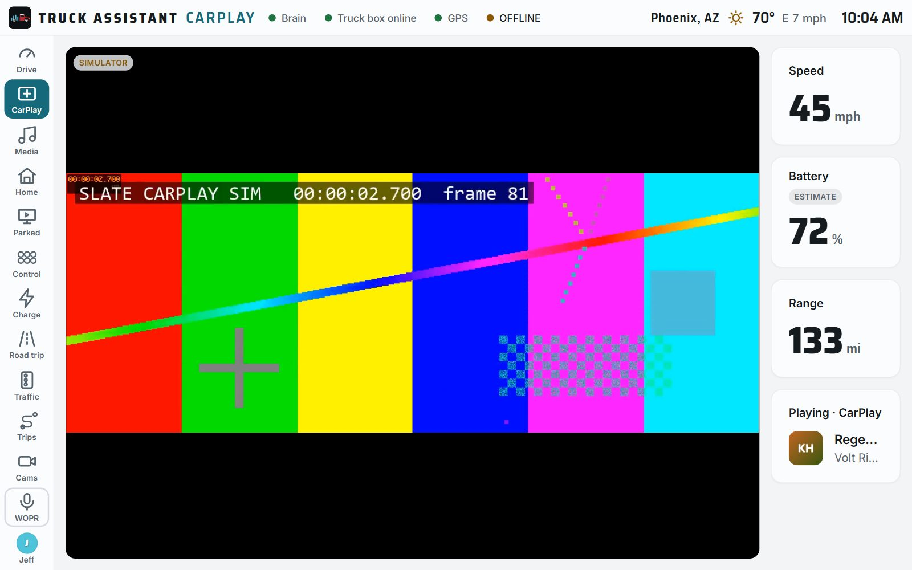

### 2.2 Cameras without cameras

Tap **Cams**. On a desk you get five moving test patterns (rear, front,
hitch, bed and 360°). Real cameras replace them in the truck.

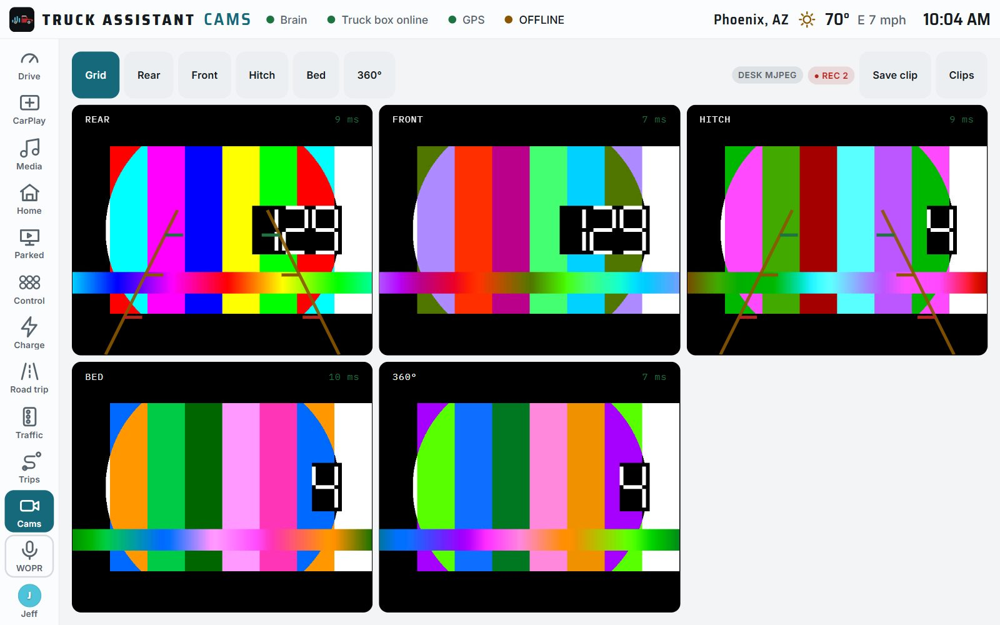

### 2.3 The test panel: drive the pretend truck yourself

At the bottom of the rail tap **Test** (it only appears with a pretend truck,
and only while parked). A panel slides out on the right:

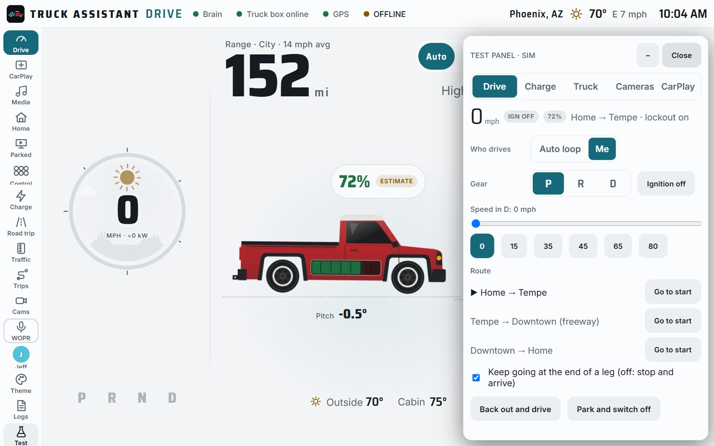

Try these, one at a time, and watch the cockpit react:

1. **Gear: R.** The rear camera comes up with parking lines.
2. **Gear: D**, then speed **45**. The truck drives; the Parked screen locks.
3. **Charge** tab › **Plug in at home (7.2 kW)**. The battery climbs.
4. **Truck** tab › **Bump the truck**. A "parked motion" alert fires.
5. Back on the **Drive** tab: **Park and switch off**.

Close the panel with **Close**.

### 2.4 The settings page

Go to **http://localhost:8080/settings**. This is where everything about
your truck is set up: chargers, drivers, Home Assistant, Spotify, cameras,
passwords. Each heading opens when you tap it.

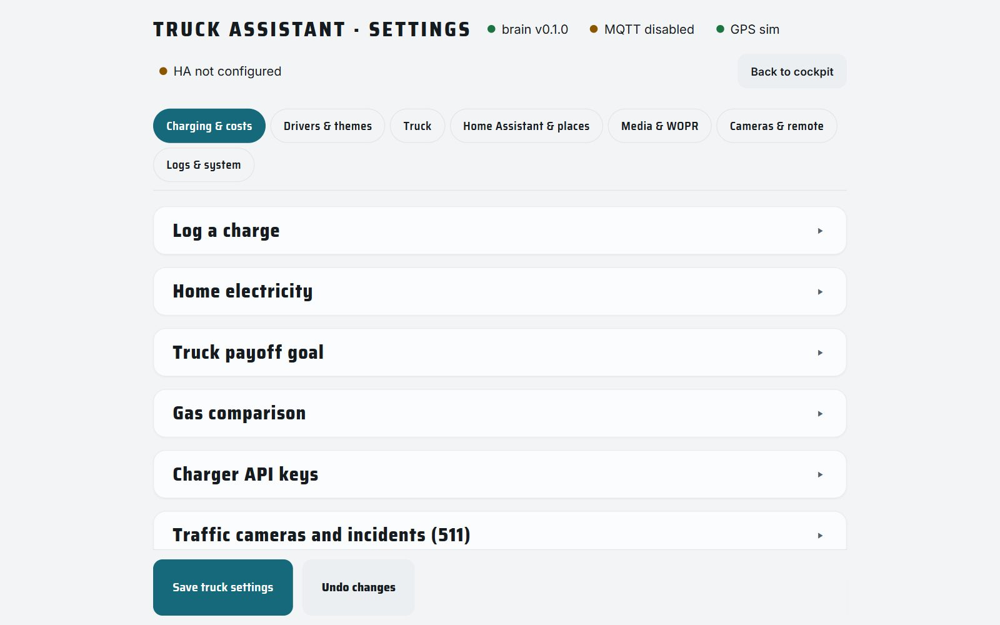

> **API keys and passwords always go here**, never in a file. They're stored
> on the brain and shown masked.

You've now seen everything the software does. The rest of this guide adds
real hardware.

---

## Part 3: The dash tablet

The main screen in the truck is an **Android tablet** (built and tested on a
Samsung Galaxy Tab S7 FE, model SM-T738U) in Slate's Tablet Mount. It shows
the cockpit in Chrome, runs CarPlay through the Carlinkit dongle, and opens
the real Netflix/YouTube apps when parked.

> **Why Android and not an iPad?** Chrome on Android can talk to the CarPlay
> dongle over USB. Safari on an iPad can't.

**You need:**

- The tablet, updated (Settings › Software update)
- A 45 W (or more) USB-C wall charger: on the desk it stands in for the
  truck's 12 V socket
- A USB-C hub **with PD pass-through** (USB-C power in, at least one USB-A
  port). Pass-through must be 45 W or more.
- A Carlinkit CPC200-CCPA wireless CarPlay dongle, and an iPhone
- Tasker from the Play Store (about $3.50)

### 3.1 Battery care first

Settings › Battery › **Protect battery** (or "Battery protection") **on**. It
stops charging at 85 %, which matters a lot in a hot cab.

### 3.2 Join the same Wi-Fi as the brain

Settings › Connections › Wi-Fi › your home network. The tablet and your
computer must be on the same network.

### 3.3 Let Chrome trust the brain's address

CarPlay over USB, the microphone and the tablet's GPS only work on pages the
browser considers "secure". The brain is a plain `http://` address on your
own network, so you tell Chrome to trust it. This is a one-time setup.

1. Open **Chrome** on the tablet.
2. In the address bar type `chrome://flags` and press Go.
3. In the **Search flags** box at the top, type `insecure origins`.
4. You'll see **Insecure origins treated as secure**. Tap the box under it
   and type both addresses, separated by a comma, with no spaces:
   ```
   http://192.168.1.50:8080,http://10.42.0.1:8080
   ```
   (Use your computer's address from step 1.5 for the first one. The second
   is the truck's; add it now so you don't have to come back.)
5. Change the dropdown next to it from **Default** to **Enabled**.
6. Tap **Relaunch** at the bottom.

### 3.4 Open the cockpit and install it as an app

1. In Chrome go to your brain's address, e.g. `http://192.168.1.50:8080`.
2. If Chrome asks to use your **location**, tap **Allow** (needed for the
   tablet-as-GPS feature; see 3.7).
3. Tap Chrome's **⋮** menu (top right) › **Add to Home screen** › **Install**.
4. Go to the home screen. There's a new **Slate Cockpit** icon. **Always open
   the cockpit from this icon from now on**: it runs full screen with no
   address bar.

### 3.5 CarPlay

Wire it up as in the picture at the top of this guide:

1. Wall charger → the hub's **power-in** USB-C port.
2. The hub's USB-C plug → the tablet.
3. Carlinkit dongle → one of the hub's **USB-A** ports.

Check the tablet's battery icon shows **charging**. If it doesn't, the hub's
pass-through isn't working: try another charger or another hub before going
further.

Then:

1. Open the cockpit from its icon and tap **CarPlay**, then **Connect**.
2. Chrome shows a list of USB devices. Pick the **Carlinkit** / "Auto Box" one
   and tap **Connect**.
3. On the iPhone: Settings › Bluetooth › tap the device called
   **Carlinkit…** (or "Autokit…") and accept the CarPlay prompt.

**Pass:** CarPlay appears inside the cockpit within about 30 seconds, you can
tap around in it, music plays through the tablet's speakers, and the tablet
keeps charging.

> **Important: don't let the dongle update itself.** Some Carlinkit firmware
> updates break third-party screens like this one. Turn off automatic updates
> in the dongle's own settings if it offers that, and never run "upgrade" in
> the Autokit app. Details: [deploy/pi/README.md](../../deploy/pi/README.md#firmware-dont-let-it-update).

### 3.6 Streaming apps (optional)

Install whichever you use from the Play Store (Netflix, YouTube TV, Disney+,
Max, Hulu, Prime Video…) and sign in to each once. On the cockpit's
**Parked** screen their tiles open the real app. They're locked out while
the truck moves.

### 3.7 The tablet as the truck's GPS (optional)

The tablet has its own GPS. With **Allow location** from step 3.4 (and
Android Settings › Location **on**, with Chrome allowed **precise**
location), the cockpit uses it whenever no USB GPS puck is fitted.

On the brain's settings page, **Truck** tab, the box **Use the dash tablet's
GPS when there's no GPS puck** controls it:

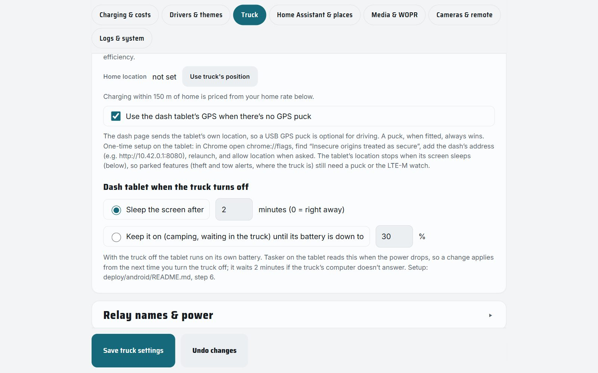

### 3.8 Tasker: wake with the truck, sleep after it

In the truck, the tablet's charger runs off the truck's 12 V socket, which is
only live while the truck is on. **Tasker** watches the charger: when power
arrives it wakes the screen and opens the cockpit; when power goes away it
waits a while (you choose how long, on the settings page) and then locks the
screen.

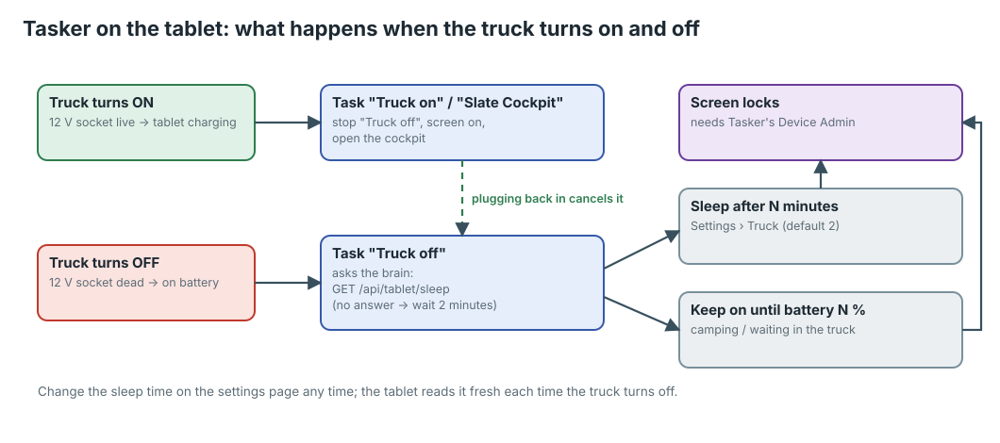

Install **Tasker** from the Play Store and open it. Accept the permissions
it asks for. Then build two tasks and one profile.

> **Tasker tips for first-timers:** the tabs along the top are **PROFILES**,
> **TASKS** and **SCENES**. In a task, the **+** at the bottom adds an action,
> and you pick it by category (Net, Variables, Task, Display, App…). The back
> arrow saves. Long-press a task to rename it.

**Task 1, named `Truck off`** (TASKS tab › **+** › name it):

| # | Category › Action | Fill in |
|---|---|---|
| 1 | Net › **HTTP Request** | Method **GET**; URL `http://<brain address>/api/tablet/sleep` (e.g. `http://192.168.1.50:8080/api/tablet/sleep`); Timeout **5**; **Structure Output** on; at the bottom, **Continue Task After Error** on |
| 2 | Variables › **Variable Set** | Name `%wait`; To `120` |
| 3 | Variables › **Variable Set** | Name `%wait`; To `%http_data.waitSec`; tap **If** and set `%http_data.waitSec` **Is Set** |
| 4 | Task › **If** | `%http_data.keepOn` **~** `1` |
| 5 | Task › **Wait** | Minutes **5**; **Until** `%BATT` **Maths: Less Than** `%http_data.minBattery` |
| 6 | Task › **Else** | |
| 7 | Task › **Wait** | Seconds `%wait` |
| 8 | Task › **End If** | |
| 9 | Display › **System Lock** | |

What it does: it asks the brain how long to wait (`120` seconds if the brain
doesn't answer), then either waits that long, or, if you chose "keep it on"
on the settings page, waits until the battery drops to your limit. Then it
locks the screen. You can open that address in any browser to see the answer
it gets:

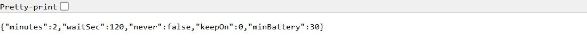

**Task 2, named `Slate Cockpit`:**

| # | Category › Action | Fill in |
|---|---|---|
| 1 | Task › **Stop** | Task **Truck off** |
| 2 | Display › **Turn On** | |
| 3 | App › **Launch App** | **Slate Cockpit** |

**The profile** (PROFILES tab › **+**):

1. Pick **State** › **Power** › **Power**. Set **Source: Any**. Tap back.
2. Tasker asks for the **entry task**: pick **Slate Cockpit**.
3. Long-press the green task name on the profile › **Add Exit Task** › pick
   **Truck off**.
4. Name the profile `Truck power` (long-press › Name).
5. Back on the main screen, tap the **✓** (Apply) at the top.

**Let Tasker lock the screen.** Tasker shows a red warning on the
System Lock action until you give it permission. Tap the warning, or go to
Android Settings › Security and privacy › Other security settings ›
**Device admin apps** › **Tasker** › **Activate**. This is a security
setting, so it's yours to turn on; Tasker can't lock the screen without it.

**Test it:**

1. Unplug the wall charger. Wait 2 minutes (or what you set). **Pass:** the
   screen locks.
2. Plug it back in. **Pass:** the screen wakes with the cockpit in front.
3. Unplug, then plug back in after 30 seconds. **Pass:** the screen never
   locked (plugging in cancels the countdown).
4. On the settings page set **Sleep the screen after 0 minutes**, save, unplug.
   **Pass:** it locks right away. Set it back to 2.

> The full reference for this tablet, including two optional extra Tasker
> profiles that bring the cockpit back to the front when you drive off from a
> Netflix stop, is [deploy/android/README.md](../../deploy/android/README.md).

---

## Part 4: The Raspberry Pi brain on the bench

In the truck, the brain runs on a Raspberry Pi in a box under the dash. The
Pi also makes the truck's own Wi-Fi network, **slate-truck**, which the
tablet and the truck box join.

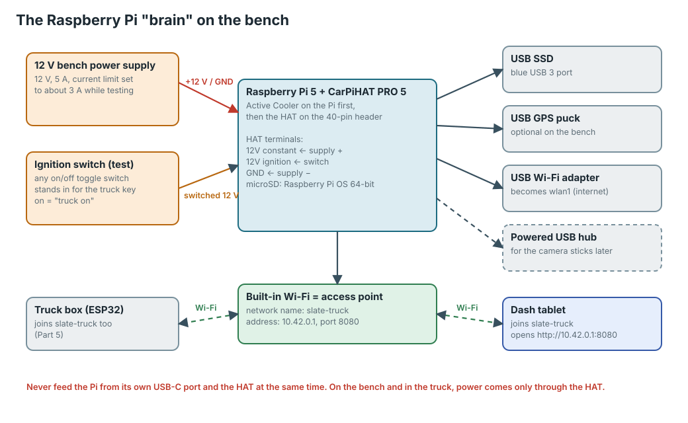

**You need** (full list with prices: [docs/bom.md](../bom.md), section 1):

- Raspberry Pi 5 (4 or 8 GB) and its **Active Cooler** (a Pi 4 also works)
- **CarPiHAT PRO 5**: the board that turns 12 V into clean power for the Pi
  and shuts it down safely when the truck turns off
- A good **microSD card**, 64 GB, "high endurance" or "industrial"
- A **USB SSD** (Samsung T7 size), 256–500 GB
- A **USB Wi-Fi adapter** with a built-in Linux driver (MT7612U, MT7610U,
  MT7601U, RTL8821CU or RTL8811CU class)
- A **USB GPS puck** (u-blox 7/8/M10, "VK-162" type). Optional if the tablet
  is your GPS.
- A **12 V bench power supply** (5 A), and a small on/off **toggle switch**
  with a bit of wire
- A computer with a microSD card reader, a USB keyboard and mouse, and a
  monitor with a micro-HDMI cable for the first boot

### 4.1 Put the Raspberry Pi OS on the microSD card

1. On your computer, download and install **Raspberry Pi Imager** from
   [raspberrypi.com/software](https://www.raspberrypi.com/software/).
2. Put the microSD card in the computer's card reader.
3. In Imager: **Device** = your Pi model; **OS** = **Raspberry Pi OS (64-bit)**
   (the one *with* desktop); **Storage** = the microSD card.
4. Click **Next**. When it offers **OS customisation**, click **Edit
   settings**: set a username and password (write them down), your home
   Wi-Fi name and password, and your time zone. On the **Services** tab tick
   **Enable SSH** if you'd like to reach it from your computer later.
5. **Save**, **Yes**, and wait for it to write and verify (5–15 minutes).

### 4.2 Assemble the Pi stack

Work on a clean, dry table. Touch something metal first to get rid of static.

1. Stick the **Active Cooler** onto the Pi (peel the pads' backing; press
   the two push-pins through the holes) and plug its little fan cable into
   the **FAN** socket.
2. Screw the **standoffs** that came with the CarPiHAT into the Pi's four
   corner holes.
3. Line the HAT's black socket up with the Pi's 40 metal pins and press
   straight down, evenly, until it's fully seated. Screw it down on the
   standoffs.
4. Put the microSD card in the slot on the underside of the Pi.
5. Plug in: the **SSD** and the **USB Wi-Fi adapter** into the two **blue**
   (USB 3) ports; the **GPS puck** into a black port. Keyboard, mouse and the
   micro-HDMI monitor cable (HDMI 0, next to the USB-C) for now.

> **Never plug a USB-C power supply into the Pi while the CarPiHAT is
> powering it.** From now on, power only ever comes through the HAT.

### 4.3 Wire the bench power

Turn the bench supply **off** first. Set it to **12.0 V**, and if it has a
current limit, set that to about **3 A** for now.

Look at the CarPiHAT's screw terminals: they're labelled on the board. You
want three of them: **12 V constant (battery)**, **12 V ignition (switched)**
and **GND**. Follow the labels printed on your board and its manual: if they
differ from the names here, the board is right.

1. Bench supply **black (−)** → HAT **GND**.
2. Bench supply **red (+)** → HAT **12 V constant**.
3. A short wire from the bench supply **red (+)** → one leg of the **toggle
   switch**; a wire from the other leg → HAT **12 V ignition**.

Loosen each screw, push the stripped wire end (about 6 mm bare) all the way
in, and tighten. Tug each wire gently: none should pull out.

The toggle switch is your pretend ignition key: **on = truck on.**

### 4.4 First boot

1. Turn the toggle switch **off**. Turn the bench supply **on**. Nothing
   should happen (the HAT waits for "ignition").
2. Flip the toggle **on**. The Pi's light comes on and, after a minute, the
   desktop appears on the monitor.

**Pass:** the bench supply shows roughly 0.3–0.8 A, and nothing smells hot.

### 4.5 Install Truck Assistant on the Pi

On the Pi, open the **Terminal** (the black icon in the top bar) and type:

```sh
sudo apt update && sudo apt install -y git
git clone https://github.com/jraben/truck-assistant.git
cd truck-assistant
sudo ./deploy/pi/install.sh
```

It takes 15–30 minutes. Partway through it asks you to **choose a password
for the truck's Wi-Fi** (slate-truck). Pick one, write it down; the tablet
and the truck box both need it.

When it finishes, **reboot**: `sudo reboot`.

After the reboot the Pi opens the cockpit full screen by itself, with the
setup wizard.

> Run `sudo ./deploy/pi/install.sh` again any time; it's safe to repeat.
> The full Pi reference is [deploy/pi/README.md](../../deploy/pi/README.md).

### 4.6 The setup wizard

Go through it on the Pi's monitor (or later from the tablet):

1. **Admin password**: protects the settings page from phones. 8 characters
   or more.
2. **Truck Wi-Fi password**: confirm or change the slate-truck password.
3. **Truck**: an id (keep `slate`), the battery pack size, efficiency.
4. **Home**: where you park at night.
5. **Drivers**: who drives, each with their own theme.
6. **Home Assistant** (optional): its address and a long-lived token.
7. **Phone hotspots**: each driver's phone hotspot, so the truck can get
   online on the road.
8. **Gas comparison**: the gas vehicle you'd otherwise drive.

Any step can be skipped and done later on the settings page.

### 4.7 Point the tablet at the Pi

1. On the tablet, Settings › Wi-Fi › **slate-truck**, with the password from
   4.5. (Android may warn "no internet". Tap **Keep connected** / **Stay
   connected**.)
2. In Chrome go to **http://10.42.0.1:8080**. Install it as an app again
   (step 3.4): this is the icon you'll use in the truck.
3. In Tasker, open the **Truck off** task and change the HTTP Request URL to
   `http://10.42.0.1:8080/api/tablet/sleep`.

**Pass:** the cockpit loads on the tablet from the Pi.

### 4.8 Check the Pi is healthy

On the tablet or any browser on slate-truck, open
**http://10.42.0.1:8080/api/health**. You'll see a line like this:

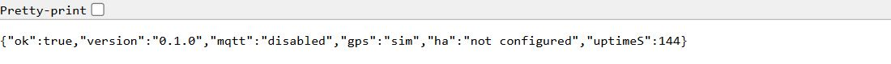

| Field | Good value |
|---|---|
| `ok` | `true` |
| `mqtt` | `connected` (the truck box's message broker; `disabled` only on a desk computer) |
| `gps` | `fix` once the puck can see the sky (put it by a window; `no fix` until then), `tablet` if the tablet is the GPS, `sim` on a pretend truck. `no gpsd` means the GPS service isn't running: re-run `install.sh` |
| `ha` | `connected` if you set up Home Assistant, otherwise `not configured` |

**The power test:** flip the toggle switch **off**. The cockpit should keep
running for a while, then the Pi shuts itself down cleanly, and the bench
supply's current drops to almost nothing. Flip it **on** and it boots again.
That's exactly what happens every time you park the truck.

> **The shutdown is the CarPiHAT's job, and it has its own setup.**
> `install.sh` does not configure the CarPiHAT. Follow the setup guide from
> its maker (TJD, sold through The Pi Hut) to turn on its safe-shutdown and
> set the delay (20–30 minutes is a good start, so a quick stop doesn't
> reboot everything). Until that's done, switching "ignition" off cuts the
> Pi's power without a clean shutdown, which can damage the microSD card.
> This step hasn't been tried on a real CarPiHAT yet: note anything that
> differs.

---

## Part 5: The truck box on the bench

The truck box is an ESP32 board with eight relays. It switches the things you
add (bed lights, light bar, compressor, fridge, inverter), reads the truck's
switches, ignition and reverse through opto-isolators, and measures cabin
temperature, battery voltage and tilt. It talks to the Pi over the
slate-truck Wi-Fi.

**You need** (list and prices: [firmware/truckbox/README.md](../../firmware/truckbox/README.md#parts-list)):

- **"ESP32 Relay Board x8"** with an ESP32-WROOM-32E. Not the "LCTech" /
  "Modbus" look-alike: check the printing on the board.
- A **3.3 V USB-serial adapter** (CP2102 or CH340) and four jumper wires
- A **Pololu D36V28F5** 5 V regulator, an **SS54** diode and an **SMBJ24A**
  TVS diode
- Optional for now: SHT31 (temperature), MPU-6050 (tilt), the PC817 opto
  module

### 5.1 Install ESPHome

ESPHome turns the settings file into firmware for the board.

- **If you have Home Assistant:** Settings › Add-ons › Add-on store ›
  **ESPHome Device Builder** › Install › Start › Open web UI. Easiest.
- **Otherwise, on your computer:** install Python from
  [python.org](https://www.python.org/downloads/), then in a terminal:
  `pip install esphome`. **On Windows use PowerShell (not Git Bash), and keep
  the folder on a path with no spaces in it**, e.g. `C:\esphome\`.

### 5.2 Fill in the secrets

1. Copy `firmware/truckbox/truckbox.yaml`, the `packages` folder and
   `tpms_decode.h` into your ESPHome folder (on Home Assistant:
   `/config/esphome/`).
2. Copy `secrets.example.yaml` to **`secrets.yaml`** in the same folder and
   open it in a text editor:
   - `wifi_ssid`: `slate-truck`
   - `wifi_password`: the slate-truck password from step 4.5
   - `mqtt_broker`: `10.42.0.1`
   - every `change-me-…`: make up a new password for each and keep a note

### 5.3 First flash

The board has no USB port, so the first flash goes through the USB-serial
adapter:

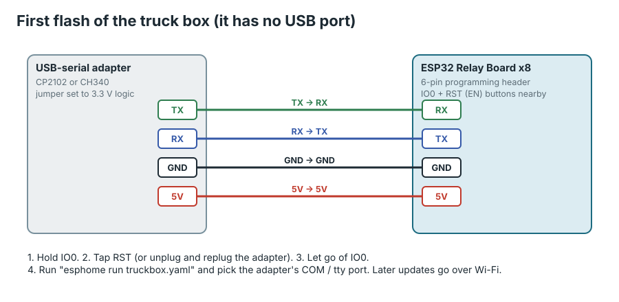

1. Set the adapter's jumper to **3.3 V**.
2. Connect four jumper wires: adapter **TX → board RX**, **RX → TX**,
   **GND → GND**, **5V → 5V**. (Yes, TX goes to RX: one side's "talk" is the
   other side's "listen".)
3. Plug the adapter into your computer.
4. Put the board into flashing mode: **hold the IO0 button, tap RST (or EN),
   then let go of IO0.**
5. Run `esphome run truckbox.yaml` (or in the ESPHome web UI: **Install** ›
   **Plug into this computer**) and pick the adapter's port (`COM3`, say, or
   `/dev/ttyUSB0`).

It compiles for a few minutes the first time, then uploads. **Pass:** the
log ends with the board connecting to Wi-Fi `slate-truck` and to MQTT.

After this first time, updates go over Wi-Fi: no wires needed.

### 5.4 Power it from 12 V like the truck will

Disconnect the USB-serial adapter. Build the power chain from the diagram
below (part A) on the bench, fed from the same 12 V bench supply:

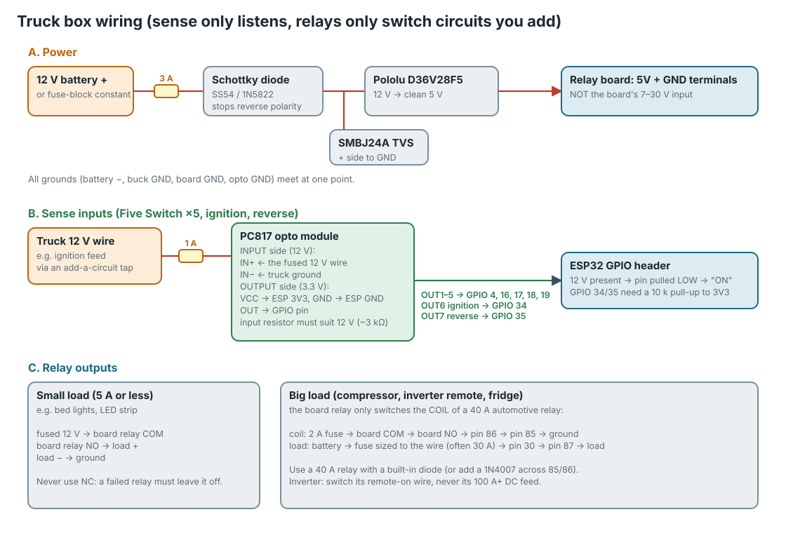

- Bench **+12 V** → **3 A fuse** → **SS54 diode** (the end with the stripe
  points away from the supply) → **Pololu VIN**.
- The **SMBJ24A** from the diode's output to ground (striped end to the
  positive side).
- **Pololu 5V out** → the board's **5V** terminal. **Pololu GND** and supply
  **−** → the board's **GND**.
- **Don't use the board's own "7–30 V" input**: its regulator isn't made for
  a vehicle's voltage spikes.

### 5.5 Check it on the cockpit

With the Pi running (Part 4) and the truck box powered:

1. The cockpit's top bar reads **Truck box online** in green.
2. Tap **Control**. Tap a relay: you hear the board click and its LED lights.
3. Tap it again: off.

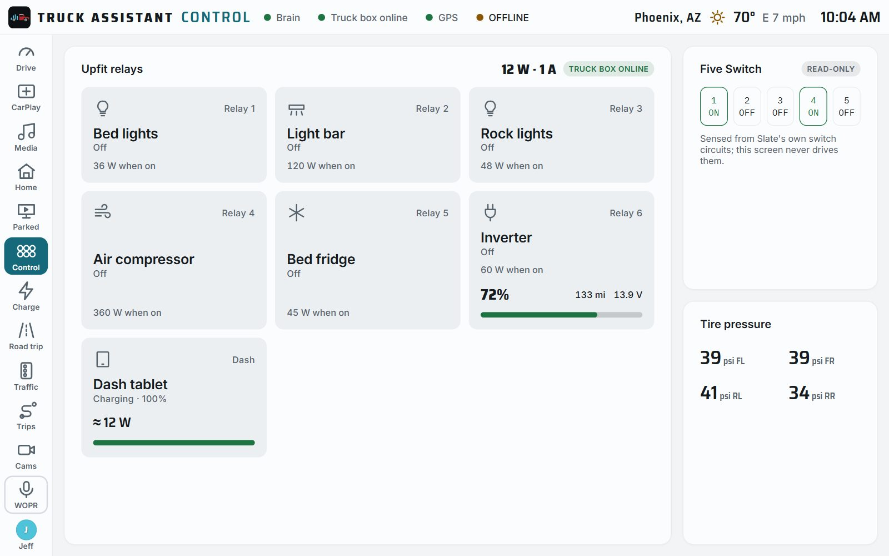

**Pass:** every relay clicks on and off from the screen, and after a power
cut every relay comes back **off** (that's on purpose: the truck box never
turns anything on by itself).

The sensors (temperature, tilt, opto inputs, battery voltage divider) can be
wired on the bench now or in the truck; part B of the diagram shows the opto
inputs and [firmware/truckbox/README.md](../../firmware/truckbox/README.md#wiring)
has the full pin table.

---

## Part 6: Sign-off checklist

Tick each one on the desk before anything goes in the truck.

- [ ] The cockpit loads on the tablet from the Pi at `http://10.42.0.1:8080`
- [ ] `/api/health` shows `"ok":true` and `"mqtt":"connected"`
- [ ] The GPS pill reads a fix (puck by a window) or `tablet`
- [ ] CarPlay shows on the tablet through the hub, **and** the tablet charges
- [ ] Tasker: unplugging locks the screen after the set time; plugging in wakes
      it with the cockpit in front
- [ ] The CarPiHAT's safe-shutdown is set up, and the toggle-switch "ignition"
      shuts the Pi down cleanly and boots it again
- [ ] **Truck box online**; every relay clicks from the Control screen
- [ ] You've written down: the admin password, the slate-truck Wi-Fi password,
      the truck box's OTA password
- [ ] You've printed the brain enclosure ([print/brain-enclosure](../../print/brain-enclosure/README.md))
      in **ASA**, not PLA or PETG

When every box is ticked, go on to the [truck install](truck.md).

## When something doesn't work

| What you see | Most likely | Try |
|---|---|---|
| Browser says "This site can't be reached" on the computer | The brain isn't running | Look at the terminal from 1.3; start it again |
| The tablet can't reach the computer's address | Firewall, or different networks | Allow Node.js on private networks (1.3); check both are on the same Wi-Fi |
| CarPlay: Chrome's USB list is empty | Hub doesn't pass data, or the dongle needs more power | Another hub; check the Chrome flag in 3.3 and relaunch Chrome |
| CarPlay keeps dropping and reconnecting | The dongle isn't getting enough power | A better charger or a powered hub |
| The tablet stops charging with the hub | The hub's pass-through is too weak | A hub rated 45 W+ pass-through, and a 45 W+ charger |
| Tasker never locks the screen | Device admin not granted | Step 3.8, "Let Tasker lock the screen" |
| Tasker locks too soon or too late | The brain's answer didn't arrive | Open the sleep address in Chrome on the tablet; if it doesn't load, fix the URL in the Truck off task |
| The Pi won't boot | Ignition switch off, or HAT not seated | Flip the toggle; reseat the HAT; check the GND wire |
| `install.sh` stops with an error | No internet on the Pi, or a typo | Check the Pi's Wi-Fi; run it again (it's safe to repeat) |
| "Truck box online" stays grey | Wrong Wi-Fi password in `secrets.yaml`, or the Pi is off | Watch `esphome logs truckbox.yaml`; fix and reflash over Wi-Fi |
| Relays click on boot | You're on the wrong board | Make sure it isn't the LCTech/Modbus version |
