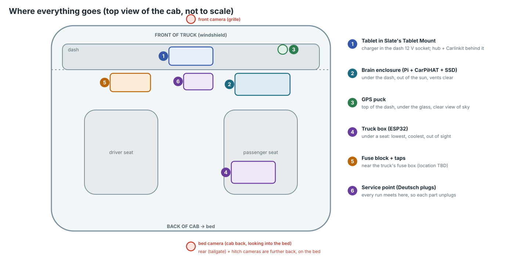
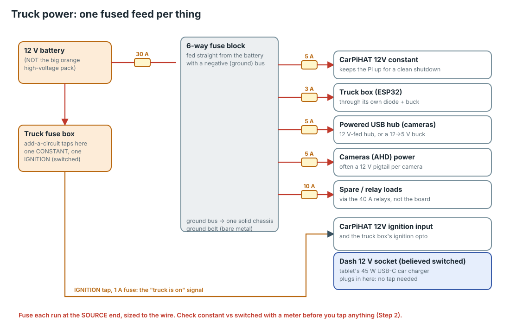
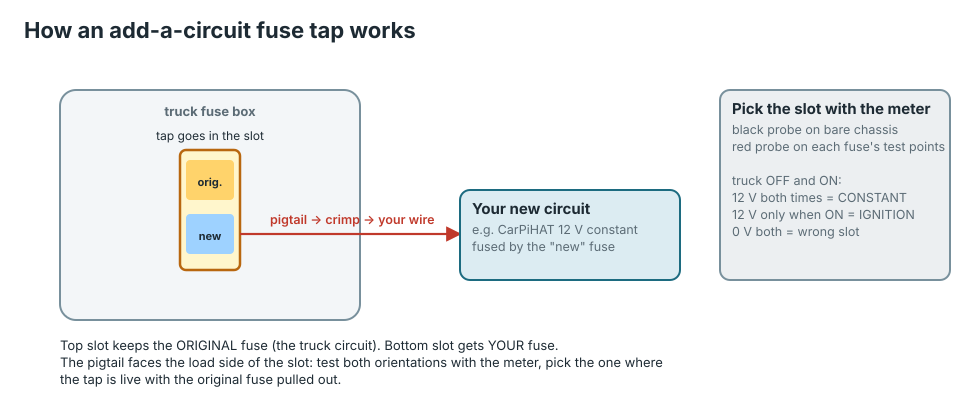
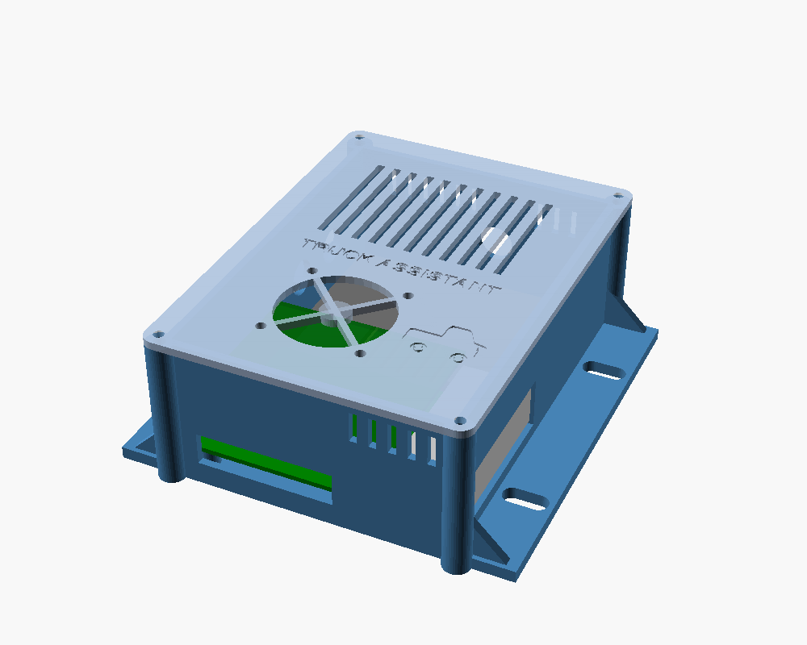
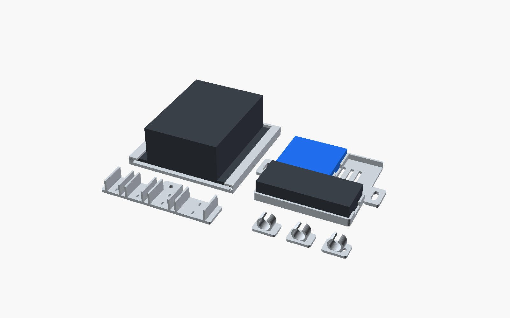
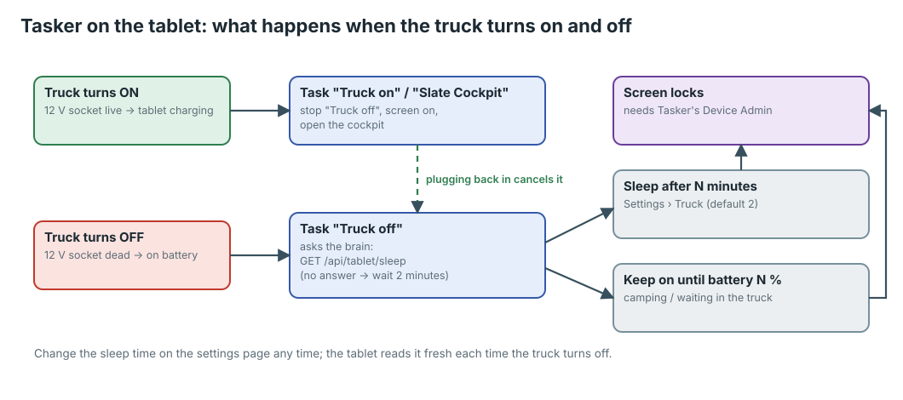
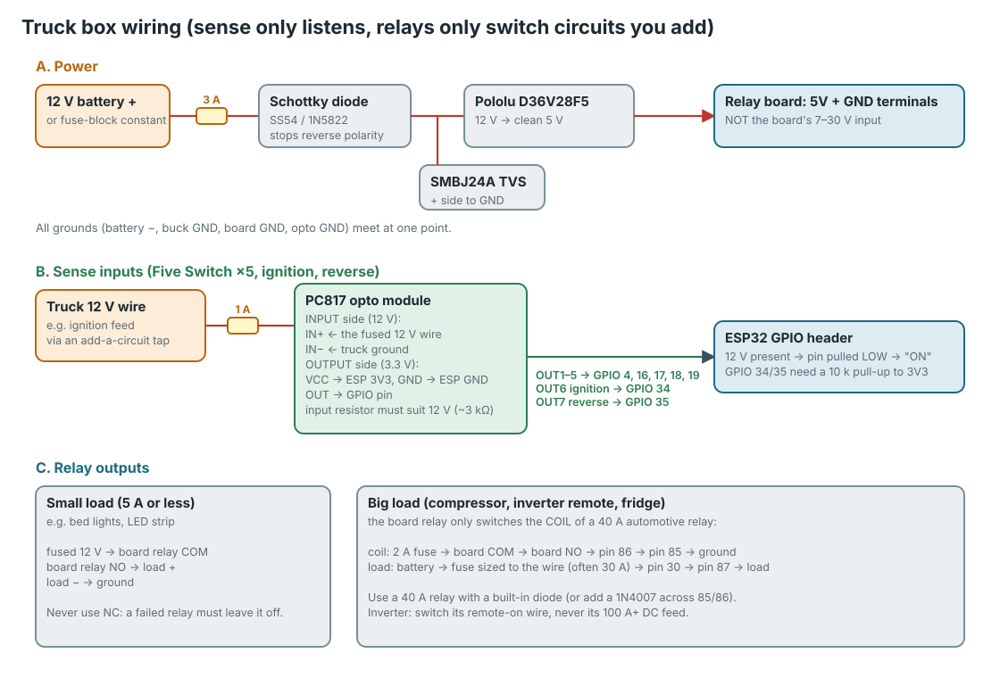
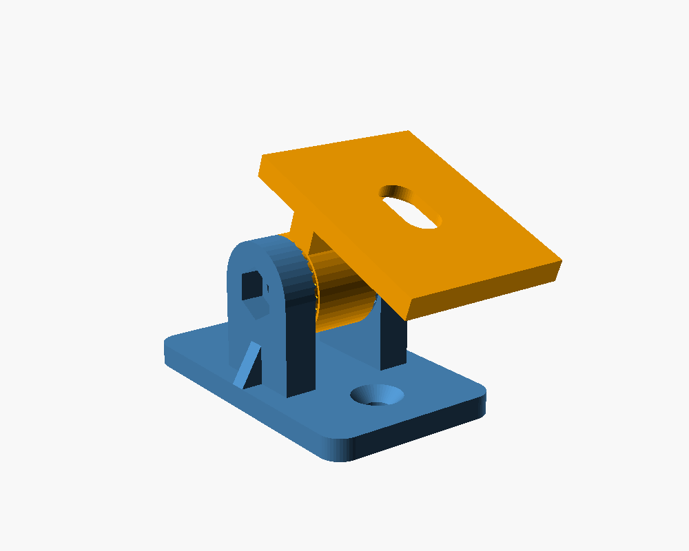
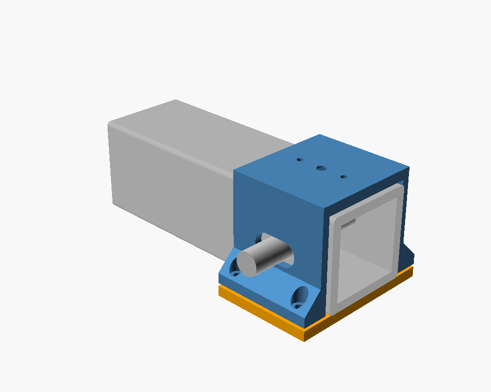
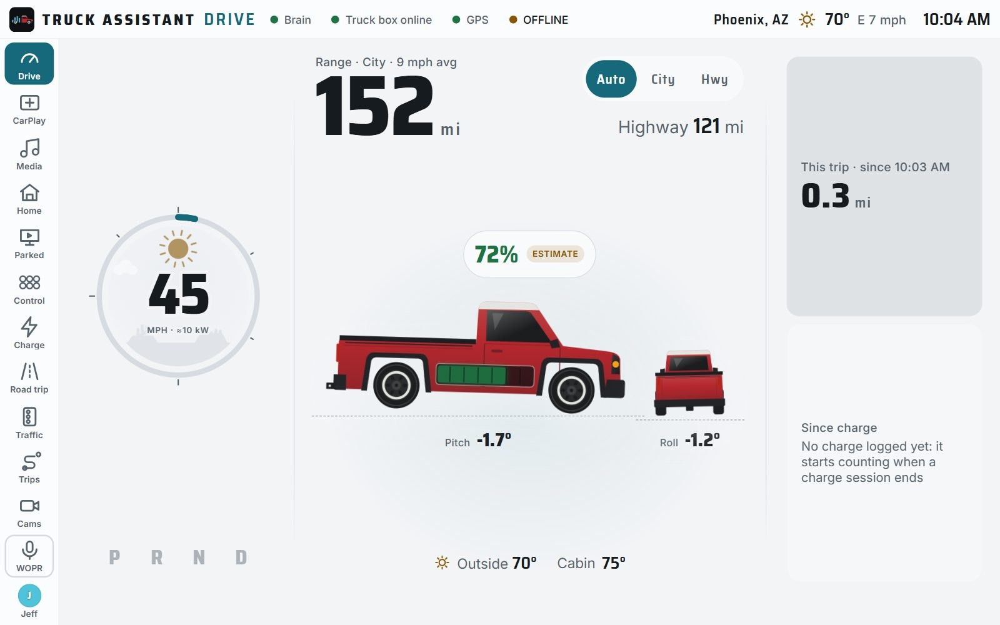

# Truck install: moving it all into the Slate

This guide follows the [desk install](desk.md). Everything should already
have been switched on and checked on a bench. **If you skipped that, go back
and do it first.** Finding a bad hub or a wrong password is a five-minute job
on a desk and an afternoon in a truck.

It's written for someone who has never wired anything into a vehicle. Read
the whole guide once before you start, and do the steps in order.

> **Nothing about a delivered Slate has been measured yet.** Fuse box
> layout, which wires are switched, where the ignition and reverse signals
> are, how much room is under the dash, how the Five Switch is wired: all of
> it is unknown until someone puts a meter on a real truck. This guide tells
> you how to **find out** each of those for yourself, and never asks you to
> cut or splice a factory wire. Where it says "check with the meter", that
> is the step.

## Before you start

### Safety, read this first

- **The Slate is an electric vehicle.** Its big battery is hundreds of volts
  and **can kill you**. Its cables are **orange**. **Never touch, cut, tap,
  pierce or zip-tie anything orange**, and never open any cover with a
  high-voltage warning label. Everything in this guide uses only the truck's
  **12 V** system, the same as any car's.
- **Disconnect the 12 V battery** before you plug anything into the fuse box
  or run a power wire, and reconnect it only to test. Follow Slate's owner's
  manual for how to do this on the Slate (an EV may want a particular
  order). Undo the **negative (−, black)** terminal first, and tuck the cable
  away so it can't spring back onto the post.
- **Every new wire gets a fuse at the end where its power comes from.** A
  wire with no fuse that rubs through on a metal edge can start a fire.
- **Never put a fuse bigger than the one you were told to.** If a fuse
  keeps blowing, something is wrong: find it, don't upsize.
- **Hot cab:** a parked Phoenix cab passes 70 °C. Printed parts are **ASA**
  (never PLA or PETG on the dash), and nothing with a battery lives on the
  dash in summer except the tablet, which you take with you or cover.
- **Warranty:** the methods here (fuse taps, existing grommets, no cutting)
  are the least invasive there are, but adding anything to a new vehicle is
  your decision. Check your warranty first.

### Tools

| Tool | What for |
|---|---|
| **Digital multimeter** | The most important tool here. Any $20–30 one with a DC volts setting. |
| Trim removal tools (plastic) | Popping panels without scratching them |
| Wire stripper and a **ratcheting crimper** | Clean, strong crimps. Pliers-style crimpers make crimps that fail. |
| Heat gun (or a lighter, carefully) | Shrinking heat-shrink tubing |
| Screwdrivers, a small socket set, a 10 mm socket | Panels, the battery terminal, ground bolts |
| Fish tape or a straightened coat hanger | Pulling wires behind panels |
| Zip ties, split loom, electrical tape, a marker | Tidy, labelled runs |
| Headlamp | You will be under the dash |

### Parts that come out of the desk build

From the desk install: the **Pi stack** (Pi + cooler + CarPiHAT + SSD + USB
Wi-Fi + GPS puck), the **tablet** with its hub and Carlinkit, and the **truck
box**. Plus, for the install ([docs/bom.md](../bom.md) sections 8 and 9):

- A **6-way blade fuse block** with a negative (ground) bus
- **Add-a-circuit fuse taps** that match the truck's fuse type (mini, low-profile
  mini or micro2: look at the fuse box first), and blade fuses 1, 2, 3, 5, 10,
  30 A
- An **inline fuse holder** and a 30 A fuse for the fuse block's feed
- **18 AWG and 14 AWG automotive wire** (TXL or GXL), red and black
- Ring terminals (for the battery and ground bolt), butt connectors or WAGO
  221 levers, heat-shrink
- A **45 W USB-C PD car charger** for the tablet
- **Printed parts in ASA:** the brain enclosure, the service kit (rail, dock,
  connector bracket, loom clips), and camera brackets if you're fitting
  cameras

---

## Step 1: Plan where everything goes

Sit in the truck with the picture above and a roll of masking tape. Mark
where each part will go. Don't drill or stick anything yet.

| # | Part | Where | Why |
|---|---|---|---|
| 1 | Tablet | Slate's **Tablet Mount** on the dash | It's made for it |
| 2 | Brain enclosure | **Under the dash**, passenger side | Out of the sun, close to the tablet and the fuse box |
| 3 | GPS puck | **Top of the dash**, against the windshield | It needs to see the sky. Metal or tinted film blocks it. |
| 4 | Truck box | **Under a seat** | Lowest and coolest spot, and out of sight |
| 5 | Fuse block | Near the truck's **fuse box** | Short power runs |
| 6 | Connector bracket | Under the dash, beside the brain | Every run meets here, so each part unplugs on its own |

Check each spot for:

- **Room to work:** you'll need to reach the plugs again later.
- **Nothing that moves:** pedals, seat rails, steering column, the glove box
  door. Sit in both seats, move them all the way back and forward, and work
  the pedals.
- **Airflow:** the brain enclosure has vents on the bottom and sides.
  Don't bury it in carpet or insulation.
- **No airbags:** never mount anything on or in front of an airbag panel
  (look for "SRS" or "AIRBAG" moulded into the plastic).

---

## Step 2: Find your power with the meter

The system needs two kinds of 12 V from the truck:

| Kind | What it is | Feeds |
|---|---|---|
| **Constant** | Live all the time, truck on or off | The fuse block, so the brain can shut down cleanly and the truck box can watch while parked |
| **Ignition (switched)** | Live only while the truck is on | The "truck is on" signal: the CarPiHAT's ignition input and the truck box's ignition opto |

The tablet's charger plugs into the **dash 12 V socket**. That socket is
*believed* to be switched; you check it in 2.3.

### 2.1 Set up the meter

1. Turn the dial to **DC volts** (V with a straight line, often "V⎓" or
   "DCV"), on the 20 V range if it asks.
2. Black probe in **COM**, red probe in **V**.
3. Touch the black probe to **bare, unpainted metal** (a seat bolt or a body
   bolt under the dash) and the red probe to the 12 V battery's positive
   terminal. You should read about **12.4–12.8 V**. If you read a minus sign,
   the probes are the wrong way round.

That bare-metal spot is your **ground** for every test below.

### 2.2 Find a constant and a switched fuse slot

Open the fuse box (the owner's manual shows where it is). Each blade fuse has
two tiny metal **test points** on top.

1. With the truck **off** (and left a few minutes), touch the red probe to
   both test points of each fuse. Write down the ones reading about 12 V.
2. Turn the truck **on**. Test them all again.

| Off | On | The slot is |
|---|---|---|
| 12 V | 12 V | **Constant** |
| 0 V | 12 V | **Ignition (switched)** |
| 0 V | 0 V | Neither: skip it |

Pick one **constant** slot and one **ignition** slot, each for something
non-critical (a cigarette socket, a dome light, a radio-type circuit), and
**never** an airbag, brake, steering or "SRS" fuse. Write them down.

### 2.3 Check the dash 12 V socket

Red probe on the socket's centre contact, black on its side wall (or bare
metal). **Off: 0 V and on: 12 V** means it's switched, and the tablet's
charger can simply plug in there. If it reads 12 V with the truck off, it's
constant: the tablet would never know the truck turned off, so the tablet's
charger needs to come from an **ignition** feed instead (an add-a-circuit
in the ignition slot to a 12 V socket or a hard-wired USB-C charger).

### 2.4 How an add-a-circuit works

An add-a-circuit takes the place of a fuse. It holds two fuses: the
**original** one, so the truck's circuit keeps working exactly as before,
and **yours**, which protects the new wire on the pigtail.

1. Pull the original fuse out of the slot (fuse pullers are often clipped
   inside the fuse box lid).
2. Push the original fuse into the tap's **lower** socket (the one nearest the
   blades) and your new fuse into the **upper** one. *(Taps differ: follow the
   drawing on the packet.)*
3. Push the tap into the slot.
4. **Orientation matters.** Turn the truck on and check with the meter that
   the pigtail is live. Then pull the original fuse out of the tap: the
   pigtail should **still** be live. If it went dead, pull the tap, turn it
   180°, and test again. *(This puts your circuit on the supply side of the
   slot, so your load doesn't run through the truck's original fuse.)*
5. Put the original fuse back.

Crimp your wire to the pigtail with a butt connector, then cover the joint
with heat-shrink.

### 2.5 Wire the fuse block

The fuse block feeds everything that needs **constant** power. With the
**12 V battery disconnected**:

1. **Mount the fuse block** near the fuse box, where you can open its lid.
2. **Ground:** a short **14 AWG black** wire from the block's negative bus to a
   ring terminal on a **bare-metal body bolt**. Scrape any paint off under the
   ring, then tighten firmly. A bad ground causes most strange electrical
   faults.
3. **Feed:** **14 AWG red** from the block's input stud to the **constant**
   source, with an **inline 30 A fuse** within 20 cm of where it connects.
   - From the battery's positive terminal is the most solid feed: a ring
     terminal under the terminal nut.
   - Or from the **constant** add-a-circuit in 2.4, if the slot's own fuse is
     15 A or more. Then use a 10 A fuse in the tap and keep the total load
     under that.
4. **Don't put any fuses in the block yet.**

Run the ignition wire separately: an **18 AWG** wire from the **ignition**
add-a-circuit (with a **1 A** fuse in it) to the brain's spot. It carries
no power, only the "truck is on" signal, so 1 A is plenty.

Label both ends of every wire with a marker on tape: `FUSE-BLK FEED`,
`IGN SENSE`, and so on. You'll thank yourself later.

---

## Step 3: The brain under the dash

### 3.1 Build the enclosure

Follow [print/brain-enclosure](../../print/brain-enclosure/README.md):

1. **Measure first** (its README lists what): the Pi + HAT stack height, the
   SSD, and the spot under the dash. The model has those as numbers you can
   change.
2. Print the box and lid in **ASA**.
3. Press the **heat-set inserts** in with a soldering iron set to about
   220 °C: let the brass sink in under its own weight, don't push.
4. Screw the Pi stack onto the standoffs, strap the SSD into its bay with the
   velcro, and fit the cable glands.

### 3.2 Mount it

The **service kit** ([print/service-kit](../../print/service-kit/README.md))
makes the brain slide out with one thumbscrew and one plug:

1. Bolt the **rail** to the lower dash support.
2. Slide the enclosure's ears into the rail and tighten the thumbscrew.
3. Mount the **dock** next to it for the Carlinkit and powered USB hub, if
   they live under the dash.
4. Mount the **connector bracket**: every run (12 V, ignition, cameras, truck
   box) gets a **Deutsch DT plug** here, so any part comes out without tracing
   wires.

### 3.3 Connect the brain's power

With the **12 V battery still disconnected**:

| From | To (CarPiHAT terminal) | Wire | Fuse |
|---|---|---|---|
| Fuse block, slot 1 | **12 V constant** | 18 AWG red | **5 A** in the block |
| Ignition wire from 2.5 | **12 V ignition** | 18 AWG (any colour, labelled) | **1 A** in its tap |
| Fuse block negative bus | **GND** | 18 AWG black | — |

Bring them into the enclosure through the glands. Push each stripped end
fully into its terminal and tighten. Tug-test.

### 3.4 The USB things

- **SSD** and **USB Wi-Fi adapter**: the two **blue** ports.
- **GPS puck**: run its cable up behind the dash panel, and stick the puck on
  the **dash top, against the windshield**. Its magnet won't hold on plastic:
  use a pad of double-sided VHB tape. If you're using the tablet as the GPS,
  skip the puck.
- **AM/FM (optional):** the RTL-SDR dongle on a short USB extension, with its
  antenna outside the cab if you can (a magnetic whip on a steel part, or a
  bed rail).

---

## Step 4: The dash tablet

1. **Mount:** the tablet goes in Slate's **Tablet Mount**. Check the fit
   (the S7 FE is about 285 × 185 mm).
2. **Power:** plug the **45 W USB-C car charger** into the **dash 12 V
   socket** (or the ignition feed from 2.3). Charger → hub's **power-in** →
   hub's USB-C plug → tablet. Carlinkit → hub's **USB-A** port.
3. **Tidy:** the hub and Carlinkit go behind the mount or in the dock, with
   velcro. Keep the cables short and out of the steering wheel's way.
4. **Wi-Fi:** Settings › Wi-Fi › **slate-truck**. Tap **Keep connected** if
   Android says there's no internet.
5. **Address:** open the cockpit from the home-screen icon you made for
   `http://10.42.0.1:8080` (desk install, step 4.7). If you only made one for
   your computer's address, open `http://10.42.0.1:8080` in Chrome and **Add
   to Home screen** again.
6. **Tasker:** open the **Truck off** task, tap the HTTP Request, and make
   sure the URL is `http://10.42.0.1:8080/api/tablet/sleep`. If your **Slate
   Cockpit** task opens a web address instead of an app, change that address to
   `http://10.42.0.1:8080/` too.
7. **Chrome flag:** `chrome://flags` › **Insecure origins treated as secure**
   must include `http://10.42.0.1:8080` (desk install, step 3.3). Without it,
   CarPlay and the tablet's GPS won't work in the truck.

---

## Step 5: The truck box under the seat

The truck box only **listens** to the truck's wires (through opto-isolators,
so no current flows back into the truck) and only **switches circuits you
added**. It never powers anything of Slate's.

### 5.1 Mount it

1. Put the board, the Pololu regulator, the diode and the opto module in an
   enclosure (a printed ASA box or a small plastic project box), with
   holes for wires.
2. **Conformal-coat** the board if you can (a spray from any electronics
   shop) against condensation.
3. Mount it **under a seat**, clear of the seat rails at every position.
4. The **MPU-6050** (tilt) must sit **flat and firm** on the box, away from
   the relays: it measures how the box is tilted, so a loose sensor reads
   rubbish.

### 5.2 Power

**12 V from fuse block slot 2, 3 A fuse** → the diode → the Pololu → the
board's 5 V terminal, exactly as on the bench (desk install, step 5.4).
Ground to the fuse block's negative bus.

### 5.3 Sense inputs (do these one at a time, with the meter)

Each input is a truck wire, through a **1 A fuse** at the tap, into the
**PC817 opto module**'s input side. The module's output side goes to the
ESP32's 3.3 V pins.

| Input | Truck signal | How to find it | Board pin |
|---|---|---|---|
| Ignition | Any **switched** 12 V | The ignition slot you found in 2.2 (a second tap, or a branch from the same 1 A wire) | GPIO 34 (opto ch 6) |
| Reverse | 12 V only in reverse | The reverse-light feed or the backup camera's power: meter reads 12 V in R, 0 V in D and P | GPIO 35 (opto ch 7) |
| Five Switch 1–5 | Each switch's output | **Unknown on a Slate: check first** (below) | GPIO 4, 16, 17, 18, 19 |

> **The Five Switch may not be five plain 12 V wires.** It may be a panel
> that talks to a controller over a data bus. Before tapping anything, find
> the wire that powers each accessory and meter it: **12 V when that switch
> is on and 0 V when it's off** means you can sense it. Anything else (a
> few volts, a signal that flickers), leave it alone. The truck box works
> fine with those inputs unconnected: they just read OFF.

GPIO 34 and 35 have no internal pull-up: add a **10 kΩ resistor from each
to 3V3** (or check your opto module has them).

### 5.4 Relay outputs

| Relay | Default name | Board terminal | Wire it as |
|---|---|---|---|
| relay_1 | Bed lights | K1 | **Direct** (5 A or less) |
| relay_2 | Light bar | K2 | Direct if ≤ 5 A, else via a 40 A relay |
| relay_3 | Rock lights | K3 | Direct |
| relay_4 | Air compressor | K4 | **Via a 40 A relay** |
| relay_5 | Bed fridge | K5 | Direct if ≤ 5 A |
| relay_6 | Inverter | **K8** (not K6!) | Its remote-on wire, or via a 40 A relay |

**K6 and K7 are not used** (they misbehave when the board boots). Label the
terminals on the box so nobody wires K6 by mistake.

- **Direct:** fused 12 V → board relay **COM**; board relay **NO** → the
  load's +; the load's − → ground. **Never NC**: if the relay or the board
  fails, the load must end up off.
- **Via a 40 A relay** (anything over 5 A): the board relay switches only
  the big relay's coil (2 A fuse); the big relay switches the load (fuse
  sized to the wire, usually 30 A). See part C of the diagram.

The names, and how many watts each draws, go on the settings page:
**Truck › Relay names & power**.

### 5.5 Battery voltage and temperature

- **12 V battery voltage:** 1 A fuse → **47 kΩ** → a junction → **10 kΩ** →
  ground. The junction goes to **GPIO 36**, with a **100 nF** capacitor to
  ground. (A tiny bit of soldering on a scrap of perfboard.)
- **Cabin temperature (SHT31):** on a 30 cm lead so it sits away from the
  relays' warmth, out of direct sun.

Full pin table and parts: [firmware/truckbox/README.md](../../firmware/truckbox/README.md#wiring).

---

## Step 6: Cameras (optional)

Outside the truck, use **AHD cameras** (sealed, 12 V, long cables). Each one
becomes a USB camera for the Pi through a small **AHD-to-USB module**, and
the modules plug into a **powered USB hub** next to the brain.

| Camera | Where | Mount |
|---|---|---|
| Front | Centre of the lower front fascia, tilted 20–30° down | [cam-bracket](../../print/cam-bracket/README.md) on VHB or 2 × M4 |
| Hitch | On the 2" receiver, looking back at the ball | [hitch-cam-mount](../../print/hitch-cam-mount/README.md) + cam-bracket |
| Bed | Top centre of the bed's front wall, looking back | cam-bracket |
| Rear (factory) | **Leave it alone**: it's the legal reverse view | — |

1. **Power:** fuse block slot 3 (**5 A**) to the cameras' 12 V leads; slot 4
   (5 A) to a **12 V → 5 V regulator** for the powered USB hub. Grounds to
   the negative bus.
2. **Routing:** along the frame rail with the trailer wiring, then up into the
   cab through an **existing** rubber floor plug, swapped for a cable gland.
   Don't drill the cab. Clip the loom every 30 cm; leave a **drip loop** (a
   U-bend lower than the hole) before every grommet, so water runs off
   instead of in.
3. **Seal every outside joint** with adhesive-lined heat-shrink, and
   dielectric grease in the connectors.
4. **Set them up:** settings page › **Cameras & remote**: pick each one from
   the list, name it, choose its size. The Cams screen shows them.

Full camera notes (heat, power budgets, bandwidth, the factory camera):
[docs/cameras.md](../cameras.md).

---

## Step 7: First power-up

Go slowly. One thing at a time, so if a fuse blows you know which circuit did
it.

1. Check nothing bare is touching metal, and every wire is clipped away from
   pedals and seat rails.
2. **Reconnect the 12 V battery** (negative last).
3. Put the **fuse for the brain** (5 A, slot 1) in the fuse block.
4. **Turn the truck on.** Within about a minute the tablet's charger wakes
   the tablet, Tasker brings up the cockpit, and the brain (booting in the
   background) appears on it.
5. Put in the **truck box** fuse (3 A, slot 2). The top bar's **Truck box
   online** turns green within a minute.
6. Then the cameras' fuses, one at a time.

**On the tablet, check:**

| Top bar shows | Means |
|---|---|
| **Brain** green | The tablet reaches the Pi |
| **Truck box online** green | The ESP32 is talking to the Pi |
| **GPS** green | A position (puck or tablet). Give it a few minutes outdoors the first time. |
| **OFFLINE** amber | No internet yet. Normal until the truck is on home Wi-Fi or a driver's hotspot (settings page › Drivers / Truck). |

Open **http://10.42.0.1:8080/api/health** on the tablet for the details
(desk install, step 4.8). On a real truck `gps` should say `fix`, and
`mqtt` `connected`.

---

## Step 8: Calibrate

### 8.1 Battery voltage

1. Let the truck sit off for 10 minutes. Measure the battery's terminals with
   the meter, e.g. **12.62 V**.
2. Read the truck box's voltage at the same moment, e.g. **12.41 V**. It's
   on the **Control** screen (beside the relays) and on the phone **Truck**
   page, with two decimals.
3. Set **Battery V Trim** to meter ÷ reading: 12.62 ÷ 12.41 = **1.017**.
   This setting lives on the truck box itself, not on the settings page: set
   it from Home Assistant (the truck box shows up there once the Pi's MQTT
   broker is bridged to your home one: the commented-out bridge section in
   `deploy/pi/mosquitto.conf`) or with an MQTT tool on a laptop joined to slate-truck. See
   [firmware/truckbox/README.md](../../firmware/truckbox/README.md#calibration).

### 8.2 Tilt

1. Park on ground you **know** is level: check with a spirit level on the
   bed rail.
2. Press the truck box's **Zero Tilt** button (in Home Assistant, like the
   trim above). Pitch and roll on the Drive screen should read 0.
3. Drive nose-up onto a ramp: **pitch should go positive**. Right side down:
   **roll positive**. If one goes the wrong way, flip that axis's sign in
   `truckbox.yaml` and reflash (over Wi-Fi).

### 8.3 Relays

On **Control**, switch each relay on and off and check the right thing
comes on. Then turn one on, switch the truck off, and wait: after **30
minutes** parked, every relay drops by itself (except the fridge), and below
**11.8 V** for 30 seconds they all drop to protect the battery. Those limits
are settings on the truck box.

---

## Step 9: The test drive

Do this with a passenger working the tablet, never yourself while driving.

- [ ] **Truck on:** the tablet wakes and the cockpit comes up within a
      minute
- [ ] **CarPlay:** the iPhone connects to the Carlinkit by itself, Waze
      shows, sound plays
- [ ] **Speed and position** follow the truck; the map moves
- [ ] **Reverse:** the rear camera comes up (if you wired the reverse
      input and fitted a camera)
- [ ] **Parked screen** is locked while moving
- [ ] **Truck off:** the tablet locks after the time set on the settings page
      (2 minutes by default); the Pi shuts down after the CarPiHAT's delay;
      the relays drop after 30 minutes
- [ ] **Short stop:** off and back on within a minute, and the tablet never
      locked
- [ ] **Next morning:** the battery voltage is about what it was the night
      before (nothing is draining it)

The overnight check matters most. Whether the Slate tops up its 12 V battery
while parked isn't known yet, and the truck box draws about 1 W around the
clock (about 0.3 W once its Wi-Fi turns off after 15 minutes parked). If the
battery is noticeably lower each morning, pull the truck box's fuse and ask
on the project's issues page before going further.

---

## When something doesn't work

| What you see | Most likely | Try |
|---|---|---|
| A fuse blows the moment it goes in | A short: bare wire on metal, or + and − swapped | Battery off; check that circuit's whole run with the meter on continuity |
| The tablet doesn't wake when the truck starts | The 12 V socket is constant, or the charger is too weak | Step 2.3; a 45 W PD charger |
| The tablet wakes but the cockpit says it can't connect | Not on slate-truck, or the brain still booting | Wait a minute; check Wi-Fi is slate-truck |
| CarPlay works on the desk but not in the truck | The Chrome flag doesn't include `http://10.42.0.1:8080` | Step 4.7 |
| GPS never gets a fix | The puck can't see the sky | Move it to the windshield; or use the tablet's GPS |
| **Truck box online** stays grey | Its fuse, its Wi-Fi password, or it's out of range under the seat | Check 12 V at its input; `esphome logs truckbox.yaml` from a laptop on slate-truck |
| Relays click when the truck starts | Wired to K6/K7 or the wrong board | Move them to K1–K5 and K8 |
| A sense input never changes | The wire isn't plain 12 V | Meter it (5.3); leave it unconnected if it isn't |
| The Pi reboots while driving | Weak power or a bad ground | Re-make the ground on bare metal; check the 5 A fuse and the CarPiHAT feed |
| The 12 V battery is low in the morning | Something stays on | Pull fuses one at a time with the meter on the battery and see which drop the draw |

## What's still unknown (help wanted)

These are open until someone measures a delivered Slate. If you're that
person, please share what you find:

1. Fuse box location, fuse type, and which slots are constant / switched
2. Whether the dash 12 V socket is switched
3. The ignition and reverse wires
4. How the **Five Switch** is wired (plain 12 V outputs, or a data bus)
5. Room behind and under the dash, and the lower dash rail's shape
6. Whether the truck tops up its 12 V battery while parked
7. The speakers: Bluetooth, passive, or powered with a line input

Related reading: [docs/forum-findings.md](../forum-findings.md) (what the
Slate forums say), [docs/bom.md](../bom.md) (the full parts list),
[docs/security.md](../security.md) (passwords, and what to do if the truck
is stolen).

---

Truck Assistant is an independent DIY project. It is **not affiliated with,
endorsed by or supported by Slate Auto**.
